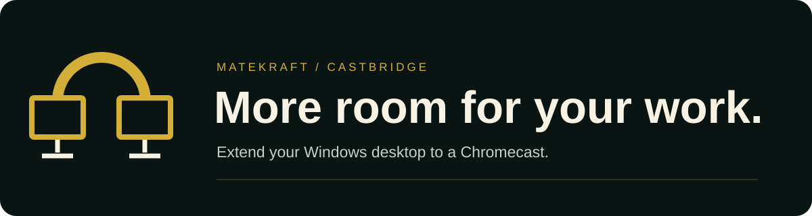

<div align="center">

**English** · [Español](README.es.md) · [Norsk](README.no.md)



# CastBridge

### More room for the work that matters.

Extend your Windows desktop to a Chromecast.<br />
**A production by [MateKraft](https://matekraft.tech).**

[Download preview](docs/downloads.md) · [Installation guide](INSTALL.md) · [Report an issue](https://github.com/akasha-code/CastBridge/issues)

[matekraft.tech](https://matekraft.tech) · [Buy me a coffee](https://www.buymeacoffee.com/matekraft)

</div>

## What it does

CastBridge creates a temporary 1280 × 720 monitor and streams that desktop to your selected Chromecast over the local network. Move a window onto the extra screen and control it with your PC's mouse and keyboard. Disconnecting normally removes the temporary monitor and restores the physical display configuration.

- Choose the receiver and the name shown on the TV.
- Remember the virtual monitor position for each receiver.
- Switch between English, Spanish and Norwegian Bokmål; your choice is saved.
- Choose Stable, Reduced or Minimum experimental latency profiles.
- Find the version, project and MateKraft website in **About CastBridge**.

## Install

1. Download **CastBridge-Setup.exe** from the latest preview release.
2. Open it, choose your language and review the prerequisite checks.
3. Select a missing requirement for instructions and its official download link. Prepare the external tools, then check again.
4. When every check passes, install and open **CastBridge** from the Start menu.

The installer and desktop interface are compiled Windows executables. The installed package contains no PowerShell scripts. The application uses the existing Python transmission engine and a native display helper.

Requirements: **Windows 11 x64**, **Python 3.12 x64 with the py launcher**, **FFmpeg with gdigrab, libx264 and HLS**, compatible signed **Virtual Display Driver 25.7.23** staged in Driver Store, the matching monitor configuration, and HTTPS access for Python dependency downloads. These are checked before copying application files. External tools are prepared separately; the installer and [installation guide](INSTALL.md) explain how.

**Preview:** the executables are not digitally signed yet. A compiled file does not replace publisher verification. Downloads remain private during validation and require GitHub access.

## Use

Choose a receiver and connect. Windows requests administrator permission to activate the temporary display. Move windows to the extra screen as on any extended desktop. Closing the main window keeps CastBridge available in the tray.

Change the latency profile while disconnected. **Jump to live** repeats synchronization during a session. Use **Disconnect** and wait for cleanup before exiting.

## Current boundaries

This is an experimental desktop extension. Manual sessions showed roughly 2.8–3.8 seconds of delay; results depend on the receiver and network. Clean installation on a second PC, suspend/resume and recovery after network interruption still require validation.

The stream stays in memory and uses local HTTP with a token and restriction to the selected receiver. Transport is not encrypted. CastBridge does not automatically change firewall rules, certificate trust, PATH or Windows security policies. Receiver connectivity is checked when connecting, not when installing.

Uninstall through Windows **Installed apps**. External prerequisites, preferences and diagnostic logs remain. Do not force-close CastBridge during an active session.

## Build and verify

The C# interface uses the .NET Framework available on supported Windows 11 systems. Builds use the Windows C# compiler and GCC x64 for the native display helper.

```powershell
.\scripts\Build-NativeHelper.ps1
.\scripts\Build-Icon.ps1
.\scripts\Build-Portable.ps1
.\.venv\Scripts\python.exe -m unittest discover -s tests -v
```

Development scripts use PowerShell; the distributed executables do not invoke it. `native/` contains the interface and installer, `prototype/` the transmission engine, and `assets/languages.json` the translation catalogue. Internal device identifiers are preserved for compatibility with existing display preferences.

## License and attribution

Original CastBridge code, documentation and project-created artwork are licensed under [Apache License 2.0](LICENSE). See [NOTICE](NOTICE) for copyright and MateKraft attribution, and [TRADEMARKS.md](TRADEMARKS.md) for the name and marks policy.

Dependencies retain their own licenses. [Third-party notices](THIRD_PARTY_NOTICES.md) document the pinned packages and external tools; copied upstream license texts are in [third_party/licenses](third_party/licenses). Apache-2.0 does not relicense those components.

## Let's start with a meaningful conversation

Useful tools start with a real problem. If CastBridge helps you, or you have a concrete idea to improve it, let's talk.

A short note is enough. We'll take it from there.

[Start the conversation](https://tally.so/r/J929pK) · [Visit MateKraft](https://matekraft.tech) · [Open an issue](https://github.com/akasha-code/CastBridge/issues)

[](https://www.buymeacoffee.com/matekraft)

Support is optional and does not change the application's functionality.
